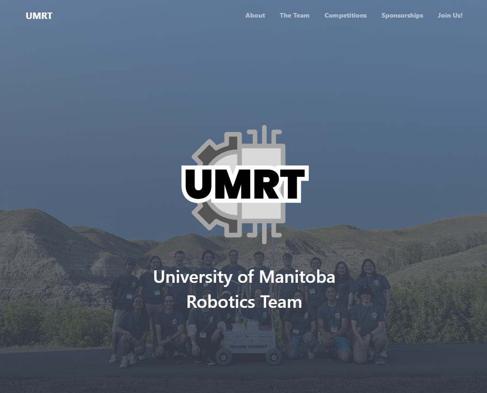

# UMRT Official Website


The official website of the University of Manitoba Robotics Team (UMRT), built with Astro and MDX and hosted on GitHub Pages.

Check out our website at [umrt.ca](https://umrt.ca)!

## Updating the Website

Use Node.js 22.12 or newer. Install dependencies and start the local preview:

```bash
npm install
npm run dev
```

This will host a live preview at http://localhost:4321.

Run `npm run build` before submitting changes. Astro validates the content collections and generates the static site in `dist/`.

### Projects and Rover Directory

`/projects/` is an interactive explorer. Expand a program in the left directory,
choose a season, then browse the design overview and subsystem tabs in the right
pane. Changing seasons or subsystems updates the design pane on the same page.

Selections have shareable links, such as
`/projects/#design=rovers/2026-prairie-panther/overview` or
`/projects/#design=rovers/2026-prairie-panther/robotic-arm`. Selecting a different
season opens its overview; selecting a subsystem changes tabs in place. Existing
program and robot URLs continue to open the same explorer with that selection
preselected.

Projects are organized by program, so UMRT can add other competition teams
without changing the rover content. Only programs with a content entry appear in
the directory. Micromouse and VEX can be added through the same structure when
those teams launch. The explorer documents the robots and their engineering.

The content schema lives in `src/content.config.ts`. The explorer uses two MDX collections:

| Content | Location | Purpose |
| --- | --- | --- |
| Programs | `src/content/programs/*.mdx` | One category or competition team, such as Rovers |
| Projects | `src/content/projects/*.mdx` | One robot design, linked to its program |

#### Adding a rover

Create a file in `src/content/projects/`, using the existing entries as examples. The filename becomes the project's stable identifier and must be unique across all programs. For example, `2027-rover.mdx` would use this frontmatter, with your confirmed copy and photo:

```yaml
---
program: rovers
name: "2027 Rover"
season: "2026-2027"
year: 2027
summary: "A short description of the rover's design and main hardware."
image: "./images/2027-rover.jpg"
imageAlt: "Describe the rover and the setting shown in the photo."
systems:
  - name: "Embedded"
  - name: "Communication Operations"
  - name: "Electrical"
  - name: "Chassis"
    description: "Describe the confirmed chassis layout and its main components."
    photo:
      image: "./images/2027-chassis.jpg"
      alt: "Describe the frame, wheels, and other hardware shown in this photo."
  - name: "Robotic Arm"
  - name: "Mission Control"
links:
  - label: "Source code"
    href: "https://github.com/UMRoboticsTeam"
---
```

Put the photo at the referenced path, relative to the MDX file, or reference an existing image under `src/content/`. Write the rover's Design Overview below the frontmatter using Markdown. Focus on the machine: its design goals, chassis, suspension, arm, electronics, embedded control, communications, and software where those details are confirmed. Use technical documentation, CAD, source code, and build photos as evidence; project pages are not team rosters.

`systems` is an optional array of `{ name, description?, specifications?, photo?, links? }` entries. Preserve each season's section structure: **Chassis**, **Robotic Arm**, **Communication Operations**, **Electrical**, and **Embedded**, plus **Payload** in 2023–2024 or **Mission Control** from 2024–2025 onward. Mission Control covers science-task preparation, mission planning, and the underbody servo scoop development. Document each section's contribution to that robot's design. A name-only entry is an authoring reminder. New programs can use their own section names through the same schema.

Subsystem `links` use the same `{ label, href }` shape as project links and appear beside the selected section. Link to the matching year's implementation or technical brief. The source notes in [docs/rover-content-sources.md](docs/rover-content-sources.md) record the dated code snapshots, recovered photo provenance, and team-provided history used for the rover entries. Keep development plans distinct from hardware confirmed in the field.

Each subsystem can include a `photo` object with `image` and `alt`. Both fields are required together when the object is present. Choose a photo of that subsystem's hardware; a complete rover photo can provide context when no detail photo exists. Paths are relative to the MDX file, just like the project's main `image`. The selected subsystem's photo accompanies its description and specifications in the design pane.

`specifications` is an optional array of `{ label, value }` entries rendered as a specification table. Use the project-level array for overall measurements such as mass and dimensions. Each system can also have its own `specifications` array for measurements belonging to that section, such as confirmed arm reach under Robotic Arm or wheel diameter under Chassis. Per-system tables appear alongside that section's description.

For example, add a verified dimension as `label: "Width"` and `value: "<measured value> mm"`; replace the placeholder before publishing. Include units and use confirmed measurements or documented ratings. Omit unknown measurements, arm degrees of freedom, drive details, autonomy claims, and performance figures rather than estimating them. All specification arrays default to empty, so unfilled tables stay hidden.

`links` is optional and should point to the design's CAD, source code, technical documentation, or demonstration video when available. The program reference must match an existing program filename without `.mdx`; invalid references fail the build. `year` determines the directory's newest-first order.

This entry automatically appears under Rovers in the explorer. Keep filenames stable after publication so saved selections and existing links continue to work.

#### Adding another program

When another team launches, create a program file such as `src/content/programs/micromouse.mdx` with `name`, `summary`, `image`, `imageAlt`, and an optional numeric `order` (defaults to `0`). Lower order values appear first, followed by alphabetical name. Add an overview below the frontmatter.

The program appears as an expandable group in the explorer. Add robots to the projects collection with `program: micromouse`. The shared explorer works without adding program-specific component files.

### Updating Team Members
[Connor insert setup steps here].

### Updating Sponsors
[Connor insert setup steps here].

### Updating showcase highlights photos
[Connor insert setup steps here].


## Github Pages Deployment
After pushing your changes to the main branch, the GitHub Actions workflow will automatically:
1. Uploads the output as an artifact
2. Deploys the artifact to GitHub Pages
